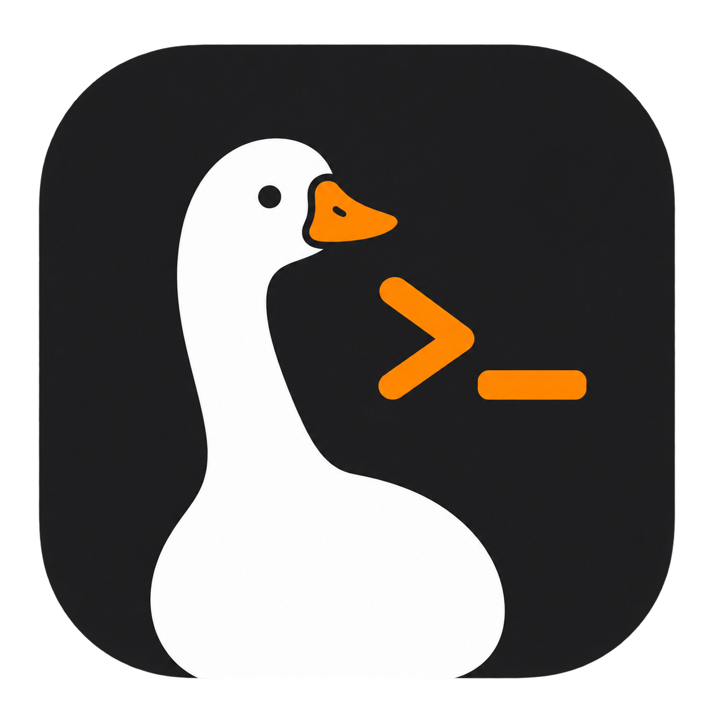
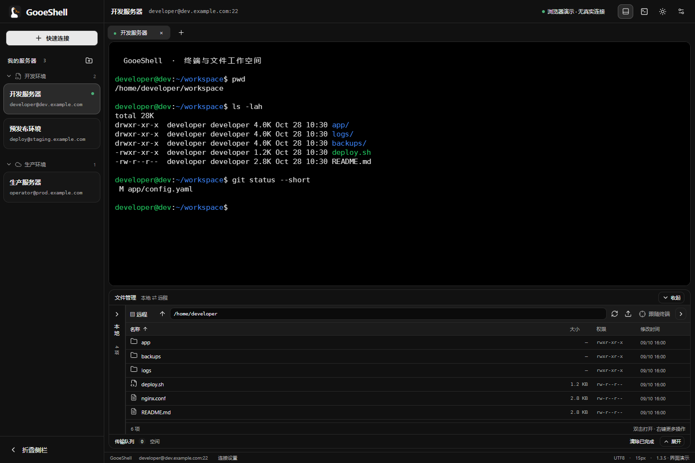
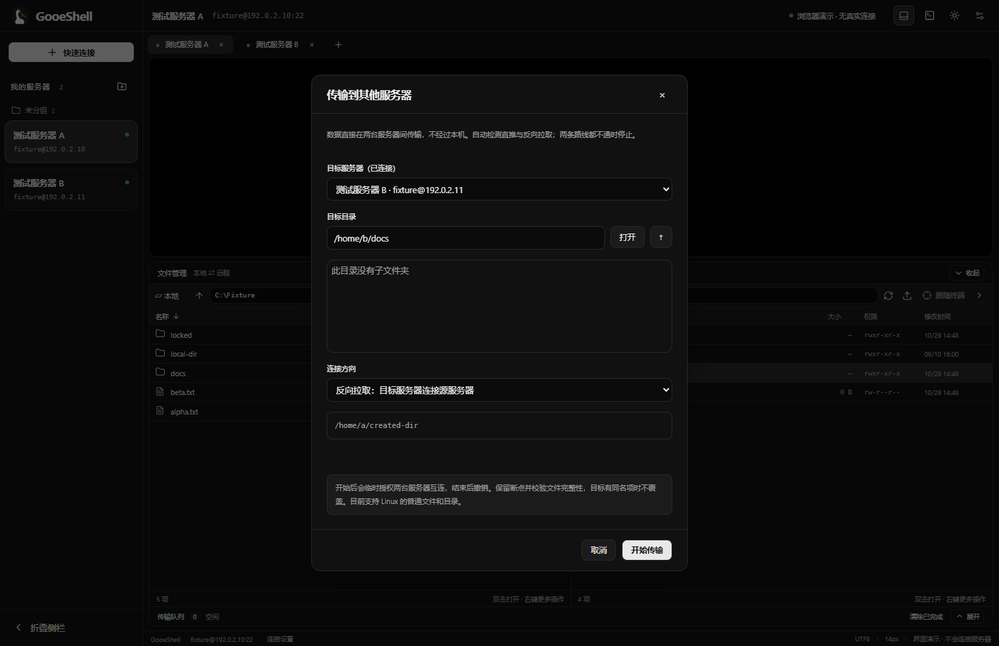
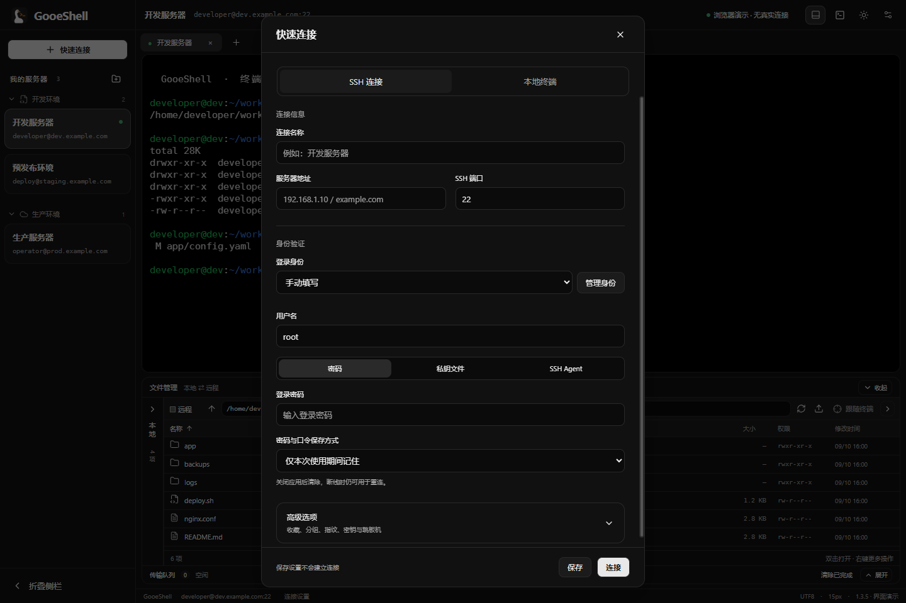
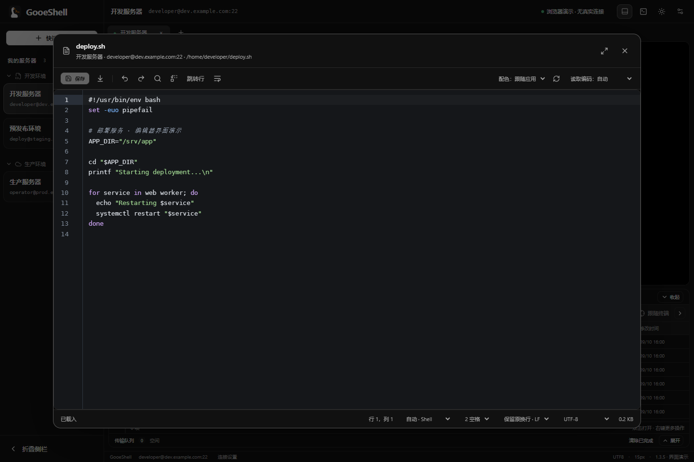

<p align="center"></p>

<h1 align="center">GooeShell</h1>

<p align="center">终端、文件和常用命令，放在一个工作空间。</p>

<p align="center">
  <a href="https://github.com/gooesman/gooeshell/releases/latest">下载正式版</a> ·
  <a href="docs/USER-GUIDE.md">使用说明</a> ·
  <a href="docs/MCP.md">AI / MCP 接入</a> ·
  <a href="https://github.com/gooesman/gooeshell/issues">反馈问题</a>
</p>

GooeShell 是 Windows 优先的桌面终端工具，也提供 macOS 和 Linux 构建。它把 SSH、本地终端、远程文件管理和文本编辑整合到可折叠的界面里：平时专注终端，需要时再展开文件区或命令库。

当前源码版本：**1.5.0**。可下载版本和各平台安装包以 [Releases](https://github.com/gooesman/gooeshell/releases) 为准。



*截图使用隔离的演示数据；其中的连接和终端输出用于展示界面。*

## 能做什么

| 功能 | 说明 |
| --- | --- |
| SSH 与本地终端 | 多标签；密码、私钥、SSH Agent；Windows PowerShell / CMD，以及 macOS、Linux 系统 Shell。 |
| 连接管理 | 服务器分组、最近连接、共享登录身份、单级跳板机与连接复用、公钥推送。 |
| 文件管理 | 本地 / 远程双栏，排序、新建、重命名、删除、权限设置和可选的终端目录跟随。 |
| 文件传输 | 本机传输支持校验续传或压缩；服务器间支持直推 / 反向拉取、续传和完整性校验，显示速度与剩余时间。 |
| 文本编辑 | 内置编辑器支持查找替换、语法高亮与编码选择；也可按扩展名使用本机编辑器，保存后自动回传。 |
| 终端操作 | 多行粘贴预览和编辑、整体 / 逐行输入、命令状态标记和定位、分组命令库。 |
| 外观与快捷键 | 黑 / 白主题，中英文字体与字重分开设置，键盘及鼠标映射，侧栏、标题栏和文件区独立折叠。 |
| AI 连接桥接 | 本机 MCP 与 CLI 复用 GooeShell 的连接与身份，支持命令、后台任务、日志和传输。 |
| 更新与备份 | 检查并校验下载正式版；加密导出配置，合并导入到另一台设备。 |

## 下载与打开

无需自行安装 Node.js。下载后按平台打开：

| 平台 | 安装包 | 使用方式 |
| --- | --- | --- |
| Windows x64 | `GooeShell-版本-win-x64.zip` | 完整解压，打开 `GooeShell.exe`。 |
| macOS Apple Silicon | `mac-arm64.dmg` / `.zip` | 将应用放入“应用程序”。 |
| macOS Intel | `mac-x64.dmg` / `.zip` | 将应用放入“应用程序”。 |
| Linux x64 | `.AppImage` / `.deb` | AppImage 添加执行权限后运行；Debian / Ubuntu 也可安装 DEB。 |

macOS 最低版本为 13，当前构建尚未完成 Apple Developer ID 签名与公证。Linux 的构建与自动验收使用 Ubuntu 24.04；其他发行版仍需实机验证。每次正式发布附带 SHA-256 校验文件和构建信息。

## 开始使用

1. 点击 **快速连接**，选择 **SSH 连接** 或 **本地终端**。
2. SSH 连接填写地址，在“身份验证”中输入账号或选择已有登录身份；跳板机、公钥和分组等位于“高级选项”。设置可以先保存，不必立即连接。
3. 左侧点击已保存服务器可直接连接。标签栏的 **＋** 打开新标签页，再从最近连接或快速连接开始。
4. 顶部文件夹按钮展开终端下方的文件区。本地栏和传输队列可分别展开；文件操作通过右键菜单完成。
5. 已连接两台服务器时，可右键远程文件选择 **传输到其他服务器**，选择目标目录和传输方向。





### 编辑远程文件

双击普通文本文件打开内置编辑器。需要使用 VS Code 等本机程序时，右键选择 **用外部编辑器打开**，并在 **设置 → 外部编辑器** 为不同扩展名指定程序。

外部保存后自动回传；远端内容有变化时暂停并提示比较。退出或断线会保留本地草稿，回到原连接后可恢复回传。内置和外部编辑的支持范围见[使用说明](docs/USER-GUIDE.md#文本编辑)。



### 常用快捷键

均可在 **设置 → 键盘与鼠标** 修改，也支持单键和鼠标按键。

| 操作 | 默认快捷键 |
| --- | --- |
| 快速连接 | `Ctrl+Shift+P` |
| 设置 | `Ctrl+Shift+F1` |
| 切换标签 | `Ctrl+Shift+←` / `Ctrl+Shift+→` |
| 折叠侧栏 / 终端标题栏 | `Ctrl+Shift+[` / `Ctrl+Shift+]` |
| 文件区 / 命令库 | `Ctrl+Shift+E` / `Ctrl+Shift+M` |
| 重连当前断开的终端 | `Ctrl+Shift+R` |
| 上一条 / 下一条命令 | `Ctrl+↑` / `Ctrl+↓` |
| 全屏 / 最大化 | `F11` / `Ctrl+Shift+F10` |

多行粘贴窗口支持直接编辑：**Enter** 整体粘贴，**Ctrl+Enter** 进入逐行模式，**Shift+Enter** 换行；逐行模式中 Enter 执行当前行，Ctrl+Enter 填入下一行。

## 让 AI 复用连接

在 **设置 → AI 与 MCP** 中启用桥接，复制对应客户端配置。GooeShell 保持运行即可，不必把服务器密码写进 AI 客户端配置。

MCP 与随程序附带的 CLI 支持连接、短命令、后台任务、日志与文件传输。后台任务可在服务器的 `gooeshell-ai` tmux 会话中查看；普通命令不需要 tmux。详情见 [MCP 使用说明](docs/MCP.md) 和 [CLI 使用说明](docs/CLI.md)。

## 配置与功能边界

连接、设置和凭据保存在当前用户的应用数据目录，升级程序不清理这些数据。长期密码使用系统加密；服务器配置不放在共用的 `.ssh` 目录，也不会改写 OpenSSH 配置。目录与备份方法见[配置说明](docs/CONFIGURATION.md)。

- 图形版使用 **Electron + React + TypeScript + xterm.js + ssh2**，SSH 和文件操作在后台 Worker 中运行。
- 服务器间直传首版要求两端为 Linux，并安装 rsync、rrsync、Python 3 和 OpenSSH 工具；不经本机传送文件。详细条件见[传输说明](docs/SERVER-TRANSFER.md)。
- 文本编辑限 2 MiB；部分 sudo、压缩传输和高效校验功能需要远端 Python 3。压缩任务不支持跨次续传，普通传输支持校验后续传。
- 命令识别当前面向 Linux Bash；tmux 内不提供面板级命令追踪。主题调整 ANSI 配色，不会自行给无颜色输出添加语法高亮。
- Android 仍处于独立原型阶段，尚无正式移动端发布。本仓库正式发布流程目前面向桌面版。

## 开发与文档

需要 Node.js 22.12 或更新版本；完整集成测试另外需要 Python 3.12。

```sh
git clone https://github.com/gooesman/gooeshell.git
cd gooeshell/desktop
npm ci
npm run dev
```

```sh
npm test          # 默认回归测试；需要特定环境的测试会标明跳过
npm run build    # 类型检查与生产构建
npm run pack     # 在当前系统打包
```

| 文档 | 内容 |
| --- | --- |
| [使用说明](docs/USER-GUIDE.md) | 连接、文件、编辑器、命令库与已知限制。 |
| [配置与备份](docs/CONFIGURATION.md) | 配置位置、密码保存和迁移。 |
| [MCP 接入](docs/MCP.md) / [CLI](docs/CLI.md) | 工具、连接复用、sudo、后台任务与日志。 |
| [服务器之间传输](docs/SERVER-TRANSFER.md) | 路线、临时授权、断点、校验和限制。 |
| [开发基线与后续方向](docs/DEVELOPMENT.md) | 合并后的功能基线、架构与开发约定。 |
| [正式发布](docs/RELEASING.md) | 四平台构建、安装包验收和 Release 发布步骤。 |
| [测试记录](VALIDATION.md) / [性能验证](PERFORMANCE.md) | 已完成的验证与适用边界。 |
| [参与开发](CONTRIBUTING.md) / [隐私说明](PRIVACY.md) | 开发入口、问题反馈与本地数据处理。 |

GooeShell 新增代码采用 [MIT 许可证](LICENSE.md)。依赖、字体及早期原型来源见 [UPSTREAM.md](UPSTREAM.md)。废弃的 WezTerm / Rust 原型已从当前源码树移除，可在 Git 历史中查阅；构建不需要 Rust 或 Git 子模块。
